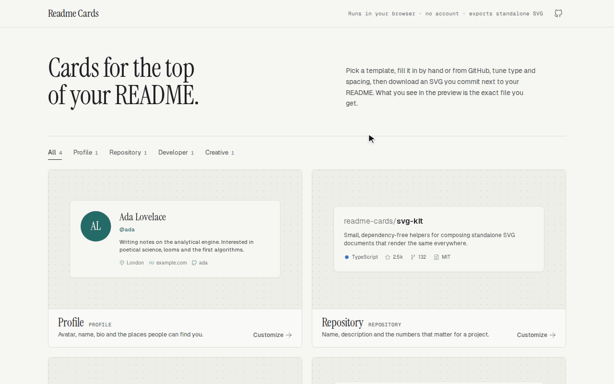
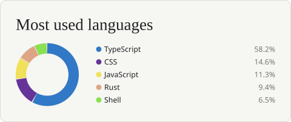
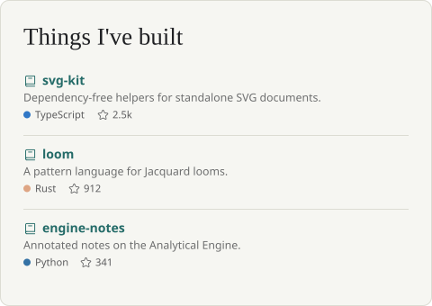
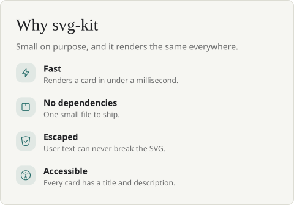
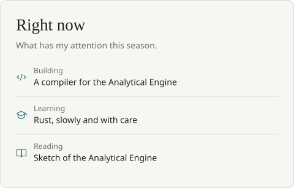
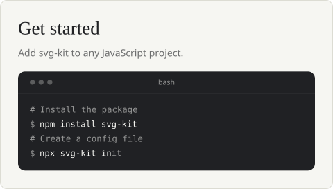
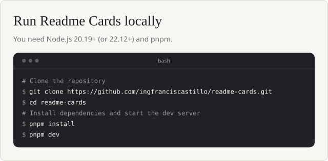

<div align="center">

# Readme Cards

**Design SVG cards for your GitHub profile and READMEs, right in the browser.**

[](https://github.com/ingfranciscastillo/readme-cards/actions/workflows/deploy.yml)


[](LICENSE)

[**Open the app**](https://ingfranciscastillo.github.io/readme-cards/) · [Features](#features) · [Examples](#examples) · [How it works](#how-it-works) · [Run locally](#run-locally)



</div>

Pick a template, fill it in by hand or from GitHub, tune the type and spacing, then download a standalone `.svg` and commit it next to your README. What you see in the preview is exactly the file you get.

There's no backend and no account. Everything runs in your browser. The only network calls are optional lookups to GitHub's public API.

## Features

- **12 templates, 33 layouts**:
  - Profile (side by side, stacked)
  - Banner (classic, accent rule, split): a wide header for the top of your README
  - Contact (rows, grid, inline): social profiles, email and website with their icons
  - Now (rows, two columns, compact): what you're building, learning and reading at the moment
  - Projects (grid, list): a few repositories side by side, imported from your GitHub profile
  - Repository (classic, spotlight)
  - Install (terminal, code block, steps): setup commands for a project README
  - Features (grid, list, checklist): what a project does well, with icons
  - Tech Stack (outlined tags, solid tags, inline list)
  - Languages (stacked bar, bars, donut)
  - Quote (quotation mark, side rule, plain)
  - Section title (rule below, side bar, centred lines): headings that match your cards
- **Live editor** with Content, Appearance, Type and Layout tabs. Every change re-renders the card immediately.
- **Light and dark mode in one file**: give a card dark colours and it follows the reader's GitHub theme. No `<picture>` tag or second file needed.
- **17 open-source fonts** to embed, among them Inter, IBM Plex, Fraunces, Playfair Display, Lora, JetBrains Mono and Fira Code, plus system font stacks.
- **Accurate preview** with zoom (fit, 1:1, steps) and transparent, light or dark backgrounds that approximate GitHub's themes.
- **Import from GitHub**: paste `octocat`, `@octocat`, `owner/repo` or a full URL to fill in the name, bio, avatar, stars and more. The Contact card picks up the social accounts listed on your profile, the Projects card your most-starred repositories, and the Languages card reads a repository's language breakdown or counts your public repositories by main language.
- **Self-contained export**: fonts and avatar are embedded, so the card looks the same through GitHub's image proxy. No remote URLs, no `<foreignObject>`.
- **Ready-to-paste snippets** in Markdown or HTML. Choose the filename and see the dimensions and file size before you download.
- **Your work is kept** in `localStorage` between visits, and any template can be reset to its defaults.
- **Share links**: copy a link that opens your card in the editor with the same settings. Nothing is uploaded; the settings travel in the link itself, without uploaded avatars.

## Examples

Six of the twelve templates, exported from the app with their default content. Each is one SVG with light and dark colours: switch GitHub's theme and they follow it. Every template and layout is in the [test repository](https://github.com/ingfranciscastillo/readme-cards-test).

<p align="center">
  
  
</p>
<p align="center">
  
  
</p>
<p align="center">
  
  
</p>

## Usage

1. Open the [app](https://ingfranciscastillo.github.io/readme-cards/) and choose a template.
2. Edit the content, or import a public GitHub profile or repository.
3. Adjust colors, fonts and layout until the preview looks right.
4. Click **Download** and save the `.svg` in your repository, for example next to `README.md`.
5. Copy the Markdown snippet and paste it into your README:

```md

```

> [!TIP]
> GitHub doesn't make images inside a README clickable. To link the card somewhere, wrap the snippet in a Markdown link: `[](https://example.com)`.

> [!NOTE]
> Dark mode follows the theme GitHub reports to the image. Chromium browsers (Chrome, Edge) use the theme picked in GitHub's settings; other browsers may follow the system theme instead.

> [!NOTE]
> The exported file is a snapshot. Numbers like stars or followers won't update on their own; export the card again to refresh them.

## How it works

The SVG string is the source of truth. React only renders the editor around it.

- **Templates are pure functions** (`src/templates/`) that turn a config into SVG markup. The preview shows that exact string and the export wraps the same card in a standalone document.
- **Escape by default**: markup is built with a small tagged template (`src/lib/svg/markup.ts`) that XML-escapes every interpolated value, so user text can't break the file.
- **Text layout by hand**: SVG has no text wrapping, so text is measured on a canvas against the loaded fonts and wrapped deterministically (`src/lib/svg/text.ts`). Blocks are stacked and rows flowed in `layout.ts` and `flow.ts`, which also gives the auto height.
- **Embedded fonts**: fonts download on demand, only the faces the card uses, and on export those same faces are embedded as base64 woff2 (Latin subset). System fonts are never embedded, and embedding can be turned off for a smaller file.
- **Embedded images**: avatars are cropped to 160 px and stored as `data:` URIs, JPEG when opaque and PNG when transparent. Without an image, initials are drawn instead.
- **Dark mode by recolouring**: templates draw with the light colours, and a `prefers-color-scheme: dark` stylesheet maps each one to its dark counterpart by attribute value (`src/lib/svg/theme.ts`). The same markup serves both themes.
- **Share links**: the card's config is JSON, compressed with the browser's `CompressionStream` and base64url-encoded into the URL hash (`src/lib/share.ts`). An incoming link passes through the same sanitiser as saved work, and the app asks before it replaces your edits.
- **Validation**: every export is parsed as XML and checked for namespace, dimensions, external references and `foreignObject`.

> [!IMPORTANT]
> GitHub import uses the unauthenticated REST API, which allows 60 requests per hour per network. Responses are cached for 10 minutes, and when the limit is hit the app tells you when it resets. Private repositories can't be read.

## Run locally



<details>
<summary>Copy the commands</summary>

```bash
git clone https://github.com/ingfranciscastillo/readme-cards.git
cd readme-cards
pnpm install
pnpm dev
```

</details>

Then open http://localhost:5173.

| Script           | What it does                                    |
| ---------------- | ----------------------------------------------- |
| `pnpm dev`       | Start the Vite dev server                       |
| `pnpm build`     | Type-check and build a static site into `dist/` |
| `pnpm preview`   | Serve the production build locally              |
| `pnpm typecheck` | Run the TypeScript compiler                     |
| `pnpm check`     | Lint and check formatting with Biome            |
| `pnpm test`      | Run the unit tests with Vitest                  |
| `pnpm format`    | Apply Biome fixes and formatting                |

The build uses relative asset paths, so `dist/` can be hosted from any static host or sub-path. Every push to `main` deploys to GitHub Pages through [`.github/workflows/deploy.yml`](.github/workflows/deploy.yml).

## Project structure

```
src/
├── templates/            card templates (pure render functions) and registry
├── lib/
│   ├── svg/              markup builder, text measurement, layout, icons,
│   │                     document wrapper, font embedding, validation
│   ├── github/           input parsing, REST client with cache, data mapping
│   ├── share.ts          share-link encoding and decoding
│   └── export/           download, clipboard, snippets
├── components/
│   ├── gallery/          template gallery
│   ├── editor/           tabs, content forms, appearance/type/layout panels
│   ├── preview/          live preview with zoom and backgrounds
│   └── export/           export panel
├── state/                persisted app state, sanitizing, render hooks
└── types/                shared types
```

### Adding a template

1. Create `src/templates/<name>.ts` exporting a `CardTemplate` (see `src/types/card.ts`) with its defaults, variants and `render` function.
2. Add its id to `TemplateId` in `src/types/card.ts`, its content type to `src/types/content.ts`, and register it in `src/templates/index.ts`.
3. Add a content form under `src/components/editor/content/` and a `case` for it in `ContentEditor.tsx`.

## Built with

[Vite](https://vite.dev/) · [React](https://react.dev/) · [TypeScript](https://www.typescriptlang.org/) · [Tailwind CSS v4](https://tailwindcss.com/) · [Iconoir](https://iconoir.com/) · [Fontsource](https://fontsource.org/) · [Biome](https://biomejs.dev/)
